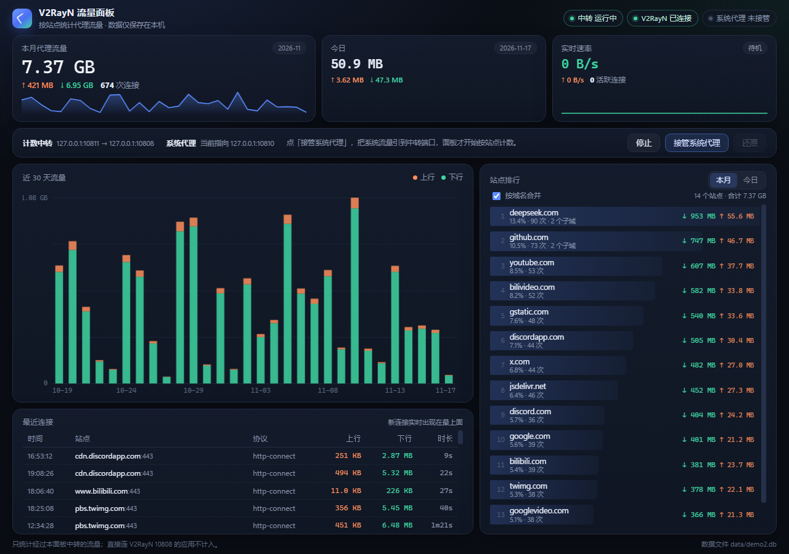

# V2RayN 流量面板

> 按站点统计代理流量 · 本月总量 · 实时速率 · 托盘常驻 · 跟着 V2RayN 自动启停
>
> A local traffic dashboard for V2RayN on Windows: per-host proxy traffic, monthly total,
> live rate, tray icon, and automatic start/stop that follows the V2RayN process.
> Zero runtime dependencies (Node 24 built-in `node:sqlite`), everything stays on your machine.



## 为什么需要它

Xray 自带的统计 API 只有「入站/出站/用户」维度的字节数，**没有按域名的流量**；
V2RayN 的「统计」和「访问日志」默认也是关闭的。所以"哪个网站用了多少代理流量"这个问题，
靠现成工具答不了。

这个项目在**本机**加一层计数中转来解决：

```
应用 / 浏览器
   │  系统代理 127.0.0.1:10810
   ▼
计数中转（SOCKS5 + HTTP 混合）
   │  按目标域名累计 上行/下行 字节
   ▼
V2RayN 本地入站 127.0.0.1:10808
   │
   ▼
你的代理节点
```

* 中转按连接记录目标 `host:port` 与双向字节数，连接结束写一行明细，同时按「日期 + 域名」聚合。
* 纯 TCP 管道：不解密、不改 UA、不改 TLS 指纹，也不额外连接任何远程地址。
* 面板展示：本月合计、今日、实时速率、近 30 天趋势、站点排行（域名合并 / 主机）、最近连接。

## 功能

- **按站点流量**：域名合并（`googlevideo.com`、`cloudfront.net` 等 CDN 归并）+ 原始主机两种视图
- **月度总量**：本月 / 今日累计，30 天趋势图，CSV 无关的本地 SQLite 存储
- **实时**：SSE 每秒推送速率与活跃连接，新连接实时插入
- **悬浮球**：桌面常驻圆形小球，实时上下行速率 + 今日用量 + 今日额度进度环，可拖动
- **上限提醒**：设置日/月额度，超额时悬浮球变红、面板顶部出现「超限」胶囊
- **设置页**：`/settings.html` 管理悬浮球开关与月/日上限
- **一屏布局**：1280×900、1366×768、1920×1080 下都不用滚动即可看完（窗口过小才回退成可滚动）
- **托盘**：蓝底 ¥ 图标，左键开面板，右键看本月流量、开数据目录
- **自动启停**：看护进程盯着 `v2rayN.exe`，V2RayN 起来就开面板并接管系统代理，退出就还原并收工
- **零依赖**：运行时只用 Node 内置模块，前端原生 JS + Canvas，没有构建步骤

## 快速开始

要求：Windows + Node.js ≥ 22.5（`node --version` 查看）+ 已安装并运行的 V2RayN（默认入站 `127.0.0.1:10808`）。

### 方式一：全自动（推荐）

```bat
install-autostart.cmd   :: 注册登录自启（当前用户，不需要管理员）
start-watch.cmd         :: 立即生效，不用重启/注销
```

之后：登录 Windows → 看护在后台待命 → 打开 V2RayN → 面板自动起来并接管系统代理。
面板地址：`http://127.0.0.1:8787`，通知区域会出现托盘图标。

### 方式二：手动

```bat
start.cmd               :: 启动面板并打开浏览器；默认不接管系统代理
```

然后在面板上点 **「接管系统代理」**。

### 方式三：命令行

```powershell
npm start                      # 或 node --disable-warning=ExperimentalWarning src/server.js
$env:TRAFFIC_AUTO_CAPTURE=1    # 启动即接管系统代理
$env:TRAFFIC_OPEN=1            # 启动后自动开浏览器
```

## 托盘图标

| 操作 | 效果 |
|---|---|
| 左键单击 | Edge `--app` 打开面板独立窗口（无地址栏/标签页） |
| 右键 → 打开面板（浏览器） | 默认浏览器打开 |
| 右键 → 状态行 | 本月 / 今日流量 + 连接次数，5 秒刷新 |
| 右键 → 打开数据目录 | 打开 `data/` |
| 右键 → 退出托盘 | 只关图标，统计不受影响，下次登录再出现 |

蓝色 = 监控中，灰色 = 面板未运行。

### 为什么独立窗口用了一个专用浏览器 profile

面板本质是一个网页，用 Edge 的 `--app` 模式去掉地址栏后看起来像独立应用，但**运行环境仍是浏览器**。
浏览器里装的内容脚本类扩展（沉浸式翻译的悬浮球、AdGuard 的拦截规则、划词/朗读插件等）会注入到
**每一个页面**，包括面板页面 —— 结果是"独立窗口"里混进了浏览器的副作用。

所以托盘和 `panel.cmd` 启动时都带：

```bat
--user-data-dir="%LOCALAPPDATA%\v2rayn-traffic\panel-profile"
```

这个 profile 是专用于面板的，**不装任何扩展**，因此没有任何注入，也不会改动你的日常浏览配置。
首次启动会自动创建（几十 MB），删掉它即可重置；不影响主 profile。

> 右键菜单里的「打开面板（浏览器）」是用你的默认浏览器打开的，那个会受扩展影响 ——
> 想要干净界面就用左键的独立窗口。
>
> 更彻底的做法是做成真正的桌面程序（WebView2 / Tauri / Electron 外壳）。
> WebView2 宿主默认不加载 Edge 扩展，能从根上杜绝注入，代价是需要额外打包和构建。

## 悬浮球与上限提醒

设置页：`http://127.0.0.1:8787/settings.html`（面板右上角 **⚙ 设置**，或托盘右键 →「设置…」）。

### 悬浮球

桌面常驻一个 66px 的小圆球（默认外观），每秒刷新：

```
   ↓ 1.2 MB/s      ← 实时下行
   ↑ 320 KB/s      ← 实时上行
   今日 156 MB     ← 今日累计
      （圆环）      ← 今日额度进度
```

- **圆环**是今日额度进度；没设上限时不画环
- 超过日/月上限时圆环变红、数字变红
- **拖动**移动位置（位置记在 `data/ball-pos.json`），**双击**打开面板
- **吸附**：拖到屏幕边缘 40px 内（或鼠标贴到屏幕边缘）会**缓动滑入**并缩成一个小凸起；单击凸起会展开，双击打开面板，鼠标移上去自动展开，移开 0.7 秒再收起
- **右键菜单**：打开面板 / 设置… / 收起·展开 / 隐藏悬浮球
- 面板没运行时显示「离线」

### 外观配置（模块化）

设置页 →「悬浮球外观」里是一份 JSON，改完点「导入配置」**立即生效**；也可以「导出当前」保存成文件。
仓库 `themes/` 里有三份示例：`compact.json`（默认 66px 圆）、`pill.json`（44px 胶囊）、`minimal.json`（96px 无环）。

```jsonc
{
  "name": "compact",
  "size": 66,                 // 直径（px）；胶囊形状时高度 = size，宽度 = size * 1.9
  "shape": "circle",          // circle | pill
  "opacity": 0.92,            // 默认透明度（设置页的滑块会覆盖它）
  "edgeSnap": true,           // 是否吸附屏幕边缘
  "nubSize": 18,              // 吸附后露在屏幕内的宽度（小凸起）
  "bg": "#121722",
  "ring": {
    "enabled": true,
    "width": 3,
    "track": "#2a3346",
    "color": "#5b8cff",
    "alert": "#ff6b6b"        // 超限时的颜色
  },
  "modules": [                // 最多 6 个，按 y 排布
    { "type": "speed.down",  "y": 0.36, "font": 11,  "color": "#3fd6a2" },
    { "type": "speed.up",    "y": 0.56, "font": 8.5, "color": "#ff8f5c" },
    { "type": "usage.today", "y": 0.73, "font": 8,   "color": "#9fb0cc" }
  ]
}
```

模块类型：

| type | 内容 |
|---|---|
| `speed.down` | 实时下行速率 |
| `speed.up` | 实时上行速率 |
| `usage.today` | 今日累计 |
| `usage.month` | 本月累计 |
| `limit.percent` | 今日额度使用百分比（没设上限时不显示） |

`y` 是垂直位置（0~1，相对高度），`font` 是字号（像素）。非法字段会被服务端校验并回落到默认值。

### 上限提醒

设置页里填日上限和月上限（MB / GB，填 0 表示不提醒）：

- 超过上限：悬浮球变红 + 面板顶部出现红色「今日超限 / 本月超限」胶囊
- 进度条实时预览，红色表示已超额
- 口径与面板一致：按**经过中转的流量**统计，不是机场计费口径；只在本地判断，不上传

### 透明度

设置页「悬浮球外观」顶部的滑条（20% ~ 100%），拖动即时生效，存在 `ballOpacity`。

### 生命周期

悬浮球由看护进程托管：开关打开就拉起，关闭就退出且不会再被拉起；面板服务收到设置后会**立即**生效，
看护进程每 30 秒再兜底检查一次。日志在 `data/ball.log`。

## 接管系统代理到底改了什么

Windows 有一个全局系统代理设置，存在注册表
`HKCU\Software\Microsoft\Windows\CurrentVersion\Internet Settings` 的 `ProxyEnable` / `ProxyServer`。
Chrome、Edge、Electron 应用、很多 .NET 程序默认都读它。

* 平时是 **V2RayN** 在写这个值：`127.0.0.1:10808`。
* **接管** = 把它改成 `127.0.0.1:10810`（本面板的中转端口），流量先到面板记账，再转给 V2RayN。
  应用的配置一个都不用动。
* **还原** = 把值写回接管前的原样（通常是 `10808`）。

接管前原值会存进数据库并落到 `data/proxy-original.json`，面板不在时也能用 `restore-proxy.cmd` 还原。
看护模式下，V2RayN 若把代理改回 `10808`，面板每 8 秒检测并重新接管；用户主动还原时不抢。

## 自动启停（看护进程）

`src/watcher.mjs` 每 2 秒检查一次 `v2rayN.exe`：

| 事件 | 动作 |
|---|---|
| V2RayN 启动 | 拉起面板（隐藏窗口），4 秒后接管系统代理 |
| V2RayN 退出 | 先还原系统代理，再关闭面板 |
| 面板被误杀 | 2 秒内重新拉起 |
| 重复启动看护 | 检测到 `data/watcher.pid` 后直接退出 |

`install-autostart.cmd` 在**当前用户的「启动」文件夹**放两个快捷方式（看护 + 托盘），
登录时静默拉起，不写计划任务、不需要管理员。卸载用 `uninstall-autostart.cmd`。

## 数据与隐私

- 所有数据都在本机 `data/traffic.db`（SQLite）：域名、端口、上下行字节数、连接时长。
  **不记录 URL、不记录内容、不上传任何地方**，程序也不发起任何外部网络请求。
- 明细保留 30 天，按日聚合长期保留（`TRAFFIC_RAW_DAYS` 可调）。
- 面板与中转只监听 `127.0.0.1`；但同一台机器上的其它用户/进程可以访问，注意共享电脑场景。

## 统计口径与边界

| 项目 | 说明 |
|---|---|
| 计入 | 经过本面板中转的连接（系统代理指向 10810，或被手动指到 10810 的应用） |
| 不计入 | 直连 `10808` 的应用（Telegram、部分 IDE 手填的 SOCKS）；UDP/QUIC 流量 |
| 起始时间 | 从第一次接管系统代理开始，之前的历史无法回填 |
| 字节含义 | 本地这一跳实际搬运的字节（含 TLS 记录开销），不是运营商/机场的计费口径 |
| 对节点的影响 | 到节点的字节与直连 V2RayN 完全一致，不额外连接远程、不改协议与指纹 |

## 常见问题

**Q：会不会增加被封的风险？**
面板只在本机 `127.0.0.1` 转发字节，不改变发往节点的协议、指纹、SNI，也不额外连接远程地址；
GFW 与机场看到的流量与之前一致。真正的变化是本机多了一层转发开销和一份本地域名记录。

**Q：面板显示「中转 已停止」？**
10810 被占用或启动失败，看控制台错误，或改 `TRAFFIC_RELAY_PORT`。

**Q：显示「V2RayN 未连接」？**
V2RayN 没启动/没连节点，或入站端口不是 10808（改 `TRAFFIC_UPSTREAM_PORT`）。

**Q：接管后上不了网？**
双击 `restore-proxy.cmd`；再确认 V2RayN 本身通：
`curl -x socks5h://127.0.0.1:10808 https://www.gstatic.com/generate_204`

**Q：有连接但没数据？**
浏览器里装了 SwitchyOmega 之类扩展且直连 10808 时不会经过面板；把扩展代理改成 10810 或关掉。

**Q：托盘图标不见了 / 看护和面板一起消失了？**
多半是被上一级进程（终端、脚本宿主、会话）连带回收了。双击 `start-watch.cmd` 重新拉起即可，
它通过 `explorer.exe` 启动，会脱离当前终端/会话的进程树。检查是否在跑：

```powershell
Get-Content data\watcher.pid, data\tray.pid
Get-NetTCPConnection -LocalPort 8787,10810 -State Listen
Get-Content data\watcher.log -Tail 20
```

看护每 30 秒会检查一次托盘，托盘被误杀会自动补起来；只有你主动「退出托盘」时
才会写 `data/tray.off`，看护见到这个标记就不再拉起（删掉该文件或重新登录可恢复）。

**Q：重启电脑后没有自动启动？**
`install-autostart.cmd` 注册的是当前用户的「启动」文件夹快捷方式，必须**重新登录/重启一次**才会生效。
没重启前可以手动运行 `start-watch.cmd`。手动「退出托盘」也会让托盘在本次登录内不再自动出现。

## 目录结构

```
v2rayn-traffic/
├─ start.cmd / start-watch.cmd      手动启动 / 启动看护+托盘
├─ install-autostart.cmd            注册登录自启
├─ uninstall-autostart.cmd          移除自启并停止
├─ restore-proxy.cmd                还原系统代理（不依赖进程）
├─ panel.cmd                        Edge --app 独立窗口
├─ src/
│  ├─ watcher.mjs                   看护：跟着 v2rayN.exe 启停面板，托管托盘与悬浮球
│  ├─ server.js                     HTTP 服务、API、SSE、自动接管与守卫
│  ├─ relay.js                      SOCKS5 / HTTP CONNECT / HTTP 计数中转
│  ├─ store.js                      SQLite 存储与聚合
│  ├─ settings.js                   悬浮球开关、月/日上限与超限判断
│  ├─ ballcontrol.js                悬浮球进程的启动/停止/存活检测
│  ├─ systemproxy.js                WinINET 代理接管/还原
│  └─ config.js                     端口、路径、保留期
├─ public/                          前端（原生 JS + Canvas，无构建）
│  ├─ index.html / app.js / style.css       仪表盘
│  └─ settings.html / settings.js           设置页
├─ scripts/
│  ├─ ball.ps1                      桌面悬浮球（可配置外观 / 边缘吸附）
│  ├─ tray.ps1                      托盘图标与菜单
│  ├─ *-hidden.vbs                  隐藏窗口启动器
│  └─ restore-proxy.ps1 / notify-proxy.ps1 / install-startup.ps1
├─ themes/                          悬浮球外观示例（导入设置页即可用）
├─ test/                            中转自检、演示数据、CDP 布局/截图工具
└─ data/                            运行时生成，不入库
```

## 开发

```powershell
npm run selftest    # 中转自检：SOCKS5 / HTTP CONNECT / HTTP 三条路径 + 字节计数
node test/seed-demo.mjs data/demo.db   # 造一批演示数据看界面
```

## 许可

[MIT](LICENSE)。仅用于个人网络流量统计，请在遵守当地法律法规与所使用服务条款的前提下使用。

